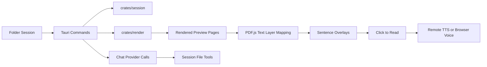

<table align="center">
	<tr>
		<td valign="middle">
			
		</td>
		<td valign="middle">
			<h1>LexiLens</h1>
			<p>Document preview, sentence-level reading, and AI-assisted study workflows in a Tauri desktop app.</p>
		</td>
	</tr>
</table>

<p align="center">
	<a href="#overview">Overview</a> |
	<a href="#current-status">Status</a> |
	<a href="#key-features">Features</a> |
	<a href="#architecture">Architecture</a> |
	<a href="#technical-approach">Technical Approach</a> |
	<a href="#installation">Install</a> |
	<a href="#usage">Usage</a> |
	<a href="#development">Development</a> |
	<a href="#limitations">Limitations</a> |
	<a href="#assets">Assets</a>
</p>

<p align="center">
	
	
	
	
	
</p>

## Overview

LexiLens is a Tauri desktop app for reading local documents with a tighter feedback loop than a traditional file viewer. It combines document rendering, sentence-aware overlays, optional text-to-speech, and a chat panel that can use the current session folder as context.

```text
Open a folder session -> choose a supported file -> preview pages -> click a sentence -> hear it spoken -> ask follow-up questions in chat
```

> [!NOTE]
> Design principle: keep reading in the foreground. AI and speech features should support the current document instead of forcing a separate workflow.

## Current Status

- Tauri v2 desktop shell is running with a React + TypeScript frontend and Rust backend.
- Session persistence stores selected folders, open files, layout state, and chat width locally.
- Markdown, PDF, DOCX, and PPTX preview flows are implemented.
- Sentence overlay + click-to-read works on PDF-backed previews with text layer extraction.
- Chat requests can include the active session folder and active file context.
- Remote provider TTS and browser voice fallback are both wired into the reading flow.

## Key Features

- Local session browser for folder-based reading workflows.
- Multi-format preview rendering through the Rust `render` crate.
- Sentence segmentation that maps extracted text back onto preview coordinates.
- Click any detected sentence in a preview to highlight it and read it aloud.
- Configurable model, base URL, API key, TTS mode, TTS voice, and speech cache size.
- Markdown-rendered assistant chat with sanitized HTML output.
- Resizable chat panel and persisted UI state between launches.

> [!WARNING]
> DOCX and PPTX text extraction depend on a local converter at runtime. LibreOffice is preferred, and Windows Microsoft Word / PowerPoint COM automation is used as fallback where available.

## Architecture

### Feature Flow



### Workspace Layout

- `src/` contains the React UI, preview logic, chat panel, and settings modal.
- `src-tauri/` contains Tauri commands, provider requests, and app entrypoints.
- `crates/render/` renders files into previewable output and extracts readable text.
- `crates/session/` stores app configuration, app state, and folder session metadata.
- `doc/` contains generated project documentation and architecture notes.

## Technical Approach

### Tech Stack

<p align="left">
	
	
	
	
	
	
	
</p>

### How It Works

- The frontend calls Tauri commands for session loading, app state, config persistence, preview generation, and chat/TTS actions.
- `crates/render` returns either markdown SVG page previews or a PDF data URL that the frontend rasterizes with PDF.js.
- Sentence rectangles are built by transforming text layer coordinates into viewport-aligned overlay regions.
- The speech pipeline can preprocess text for TTS, request provider-native audio, or fall back to the browser Web Speech API.
- The chat pipeline uses an OpenAI-compatible request path and can expose file tools for listing and reading files inside the active session folder.

> [!TIP]
> The implementation prioritizes practical reading flow over platform breadth: layout persistence, sentence targeting, and fallback behavior were built before broader content-source support.

## Installation

### Requirements

- Bun
- Rust toolchain
- Tauri prerequisites for your platform
- Optional: LibreOffice for DOCX / PPTX conversion support
- Optional: a remote model API key for provider-backed chat and TTS

### Setup

1. Install dependencies with `bun install`.
2. Start the desktop app in development with `bun run tauri dev`.
3. Build the frontend bundle with `bun run build`.

## Usage

1. Launch the app and open a folder that contains supported files.
2. Select a Markdown, PDF, DOCX, or PPTX file from the session list.
3. Configure your provider settings from the Settings panel if you want remote chat or TTS.
4. Click a sentence in the preview to highlight it and play speech.
5. Use the chat panel to ask questions about the active file or session context.

## Development

Scripts:

- `bun run dev`
- `bun run build`
- `bun run preview`
- `bun run tauri dev`

Project notes:

- The repository root hosts the Bun + React + TypeScript frontend.
- The Cargo workspace includes the active crates `src-tauri`, `crates/render`, and `crates/session`.
- The earlier placeholder pipeline crates were removed because they were not part of the running app.

## Limitations

- Preview quality and text extraction depend on the underlying document format and available local converters.
- Image-only or scanned PDFs may not produce usable sentence overlays or chat-readable text.
- Remote chat and provider TTS depend on third-party API availability and valid credentials.
- The local provider mode is still a limited path compared with the OpenAI-compatible remote flow.

## Assets

- App icon source: https://www.pixiv.net/artworks/132900053
- Generated desktop and platform icon files live under `src-tauri/icons/`.
